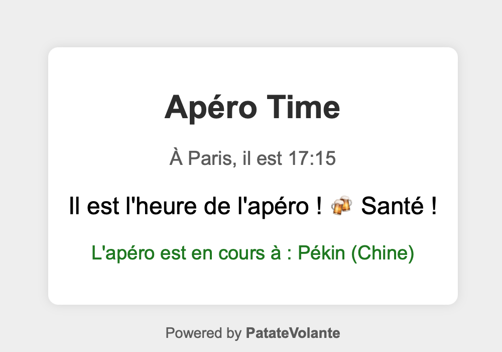

# Apéro Time 🍻

**Apéro Time** est une application web qui indique si c'est l'heure de l'apéro dans ton fuseau horaire et affiche les villes du monde où l'apéro est déjà en cours.



---

## 📋 Table des matières
1. [Fonctionnalités](#-fonctionnalités)
2. [Technologies utilisées](#-technologies-utilisées)
3. [Prérequis](#-prérequis)
4. [Installation locale](#-installation-locale)
5. [Configuration](#-configuration)
6. [Dockerisation](#-dockerisation)
7. [Personnalisation](#-personnalisation)

---

## 🌟 Fonctionnalités
- **Détection automatique** de l'heure locale pour savoir si c'est l'heure de l'apéro.
- **Affichage des villes** où l'apéro est déjà en cours (avec une ville aléatoire).
- **Interface simple et responsive** avec un design épuré.

---

## 🛠 Technologies utilisées
- **Backend** : Python 3.9, Flask, Flask-Cors, Pytz
- **Frontend** : HTML5, CSS3, JavaScript (Vanilla)
- **Conteneurisation** : Docker, Docker Compose
- **Reverse Proxy** : Traefik (optionnel)
- **Gestion des fuseaux horaires** : Base de données intégrée des fuseaux horaires mondiaux.

---

## 📌 Prérequis
- **Pour le développement local** :
  - Python 3.9+
  - pip (pour installer les dépendances Python)
  - Un navigateur web moderne (Chrome, Firefox, Edge, Safari)

- **Pour le déploiement avec Docker** :
  - Docker et Docker Compose installés ([Installation de Docker](https://docs.docker.com/get-docker/))
  - Un reverse proxy (Traefik, Nginx) pour la production (optionnel mais recommandé)

---

## 💻 Installation locale

### 1. Cloner le dépôt
```bash
git clone https://github.com/ton-utilisateur/apero-time.git
cd apero-time
```

### 2. Installer les dépendances Python

`pip install -r requirements.txt`

_(Le fichier `requirements.txt` est fourni dans le projet.)_

### 3. Lancer l'application en local

`python app.py`

- L'application sera accessible à l'adresse : [http://localhost:5001](http://localhost:5001/)

---

## ⚙ Configuration

### 1. Fichier `app.py`

- **Fuseaux horaires** : Tu peux modifier la liste des pays et villes dans le dictionnaire `timezones` (lignes 8-50).
- **Heure de l'apéro** : Par défaut, l'apéro commence à 18h. Pour changer cela, modifie la ligne :
    
    `is_apero_time = current_time.hour >= 18  # Remplace 18 par l'heure souhaitée`
    

### 2. Fichier `index.html`

- **Personnalisation du texte** : Modifie les messages dans le JavaScript (lignes 20-30).
- **Style CSS** : Adapte les couleurs, polices et marges dans la section `<style>` (lignes 6-25).

---

## 🐳 Dockerisation

### 1. Construire l'image Docker

`docker-compose build`

### 2. Lancer le conteneur

`docker-compose up`

- L'application sera accessible à l'adresse : [http://localhost:5001](http://localhost:5001/)

### 3. Arrêter le conteneur

`docker-compose down`

---

## 🎨 Personnalisation

### 1. Changer l'emoji du favicon

- Remplace le fichier `favicon.ico` par un nouveau favicon généré depuis [emojifavicon.com](https://emojifavicon.com/).

### 2. Modifier le footer

- Dans `index.html`, ligne 35 :
    
    `<footer>Powered by <strong>PatateVolante</strong></footer>`
    

### 3. Ajouter des pays ou villes

- Dans `app.py`, ajoute des entrées au dictionnaire `timezones` (exemple pour ajouter le Portugal) :
    
    `'Portugal': {     'timezones': ['Europe/Lisbon', 'Atlantic/Madeira'],     'cities': ['Lisbonne', 'Porto', 'Funchal'] },`
    

### 4. Changer les couleurs

- Modifie les valeurs CSS dans `index.html` (section `<style>`).

---

© 2025 PatateVolante. Tous droits réservés.
